# VitalPBX VoIP Lab: Debian 12 PBX with Two SIP Extensions

## 1. Lab Objective and Environment

A PBX (Private Branch Exchange) is a phone system that connects extensions inside an organization and routes calls between them. VitalPBX is a PBX built on Asterisk, with a web interface for managing extensions, trunks, and call routing. Engineers use software PBXs like this because they replace expensive proprietary phone hardware and let you design, test, and troubleshoot call flows on ordinary servers. The goal of this lab was to deploy VitalPBX on a Linux server, register two extensions on different physical devices, make calls between them, and troubleshoot the problems that came up along the way.

The server is a Debian 12 (Bookworm) 64-bit virtual machine running in Oracle VirtualBox on a Windows laptop. VitalPBX 4.5 runs on top of it, using Asterisk 20.21.0 as its telephony engine. The VM's network adapter is set to Bridged mode, which attaches the VM directly to the laptop's physical network adapter so the home router's DHCP server gives it its own address on the same network as the laptop and phone. The VM's interface is named `enp0s3` and it holds `192.168.18.142/24`.

```
            [ Home router / DHCP ]
                      |
        +-------------+--------------+
        |                            |
 Laptop (Windows)              Smartphone
 192.168.18.106                192.168.18.25
 MicroSIP (ext 101)            Sipnetic (ext 102)
 Wireshark
        |
   (bridged adapter)
        |
 VitalPBX VM (Debian 12)
 192.168.18.142
```

## 2. Installation

The server was built in two stages: first a minimal Debian 12 system, then VitalPBX on top of it.

For the Debian stage, a Debian 12 netinst ISO was booted in the VM using the Graphical Install option. The hostname was set to `vitalpbx` and the domain to `lab.local`, giving the fully qualified name `vitalpbx.lab.local`. A non-administrative user was created (`labadmin`). For storage, the guided partitioning option was used on the whole virtual disk (`/dev/sda`, about 87 GB) with all files in one ext4 partition plus a 1 GB swap partition. The package mirror was `deb.debian.org` with no HTTP proxy, and the popularity-contest survey was declined. In software selection, the Debian desktop environment and GNOME were unticked, and SSH server and standard system utilities were ticked, so the result is a headless server. The GRUB boot loader was installed to `/dev/sda`.

Once the system booted, the OS version was confirmed from the console:

```
cat /etc/os-release
```

This showed Debian GNU/Linux with `VERSION_ID="12"`, which is the version VitalPBX 4.5 requires. The VitalPBX installer was then downloaded from the official VitalPBX repository, made executable, and run as root:

```
wget https://repo.vitalpbx.com/vitalpbx/v4.5/pbx_installer.sh
chmod +x pbx_installer.sh
./pbx_installer.sh
```

The script installs and configures VitalPBX and its dependencies, then reboots the machine. After the reboot the VM showed the VitalPBX console, and the web interface loaded in a browser at `http://192.168.18.142`.

## 3. Extensions

An extension is the internal number a phone or softphone registers as, so that other extensions can call it. Two extensions were created in the VitalPBX web interface, both using the PJSIP channel driver, which is Asterisk's current SIP stack and handles each registration as a separate "contact" on the extension.

Extension 101 is named "Laptop" and is registered from MicroSIP, a Windows softphone, running on the same laptop that hosts the VM. Extension 102 is named "Phone" and is registered from Sipnetic, an Android softphone, over the home Wi-Fi. Both softphones use the PBX address `192.168.18.142` as the server, the extension number as the username, the extension's secret as the password, and UDP on port 5060 as the transport. The extension passwords are deliberately not listed in this repository.

## 4. Screenshots

The screenshots below follow the lab in order: the server and its environment, the two registered extensions, the call test between them, and the packet capture that shows what happened on the network. All image files live in the `images/` folder of this repository.

### Server and environment

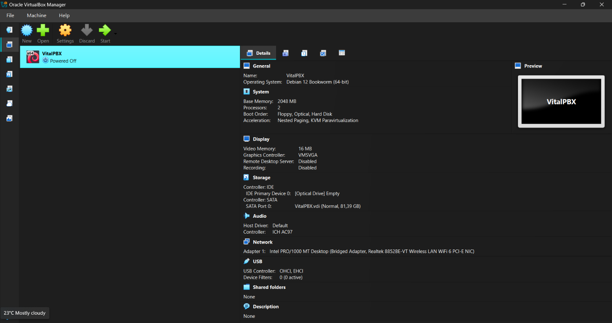

**Figure 1: VirtualBox settings for the VitalPBX VM.** The VM has 2048 MB of RAM and 2 CPU cores, and its network adapter is set to Bridged Adapter (Intel PRO/1000). Bridged mode is what lets the VM receive its own address from the home router instead of sitting behind the host's NAT.

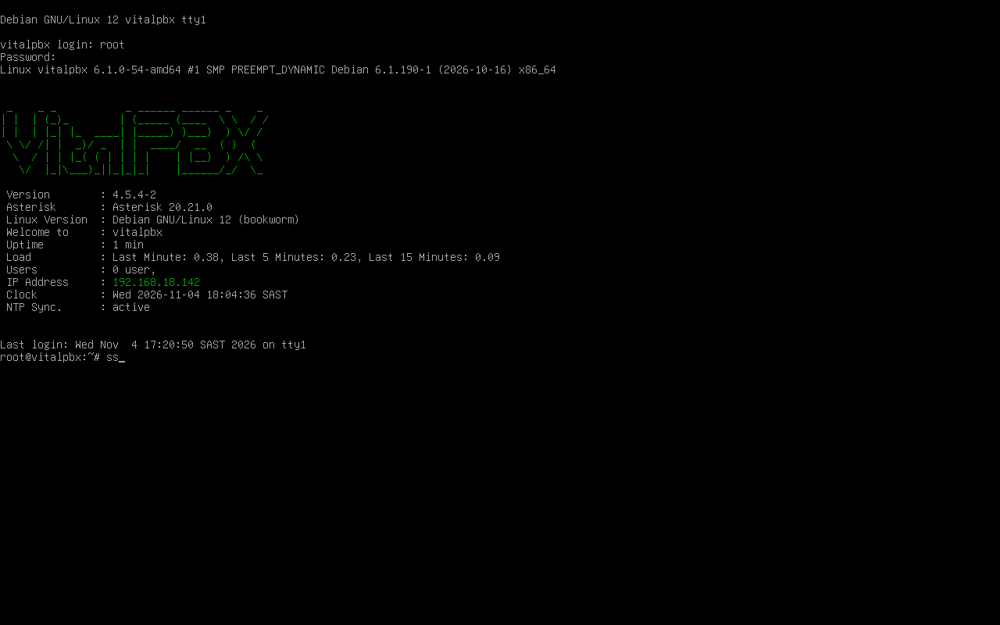

**Figure 2: Server console after login.** The banner shows Debian GNU/Linux 12 (bookworm), VitalPBX 4.5.4-2, Asterisk 20.21.0, and the server's address, 192.168.18.142.

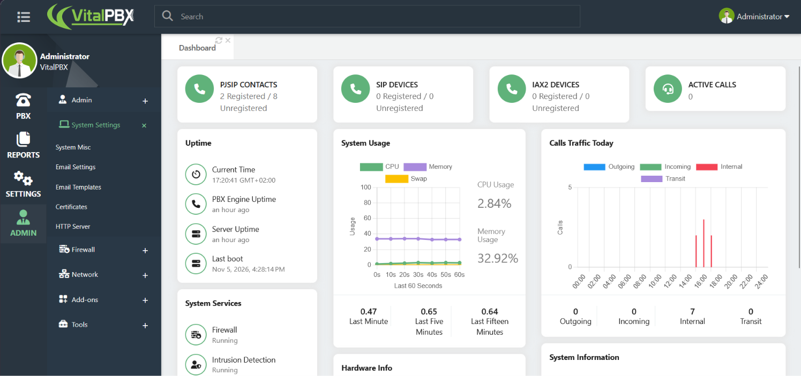

**Figure 3: VitalPBX web dashboard.** The management interface loads in a browser at `http://192.168.18.142` and shows system usage and service status.

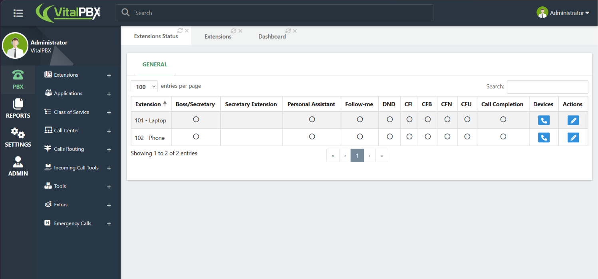

**Figure 4: Extensions list.** The two extensions created for the lab, 101 - Laptop and 102 - Phone.

### Registered endpoints

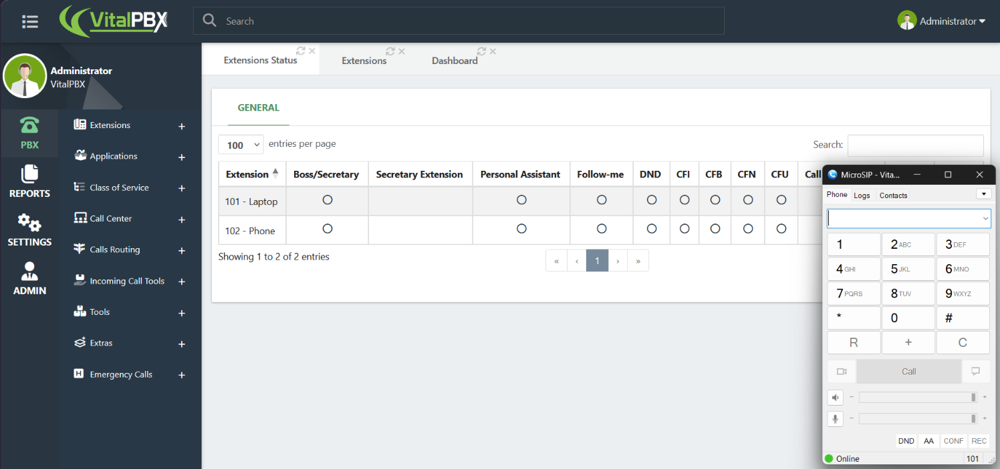

**Figure 5: MicroSIP on the laptop.** The green "Online" status at the bottom shows extension 101 is registered with the PBX.

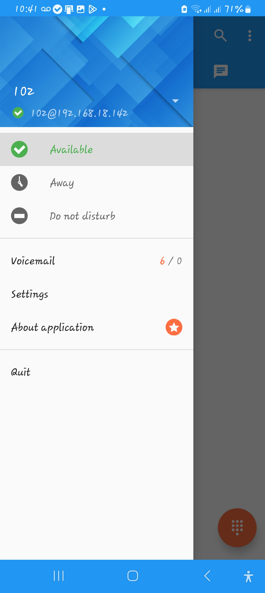

**Figure 6: Sipnetic on the phone.** The green check next to `102@192.168.18.142` shows extension 102 is registered. This is the app where the transport was set to UDP, which fixed the "unavailable" problem described in section 6.

### Call test

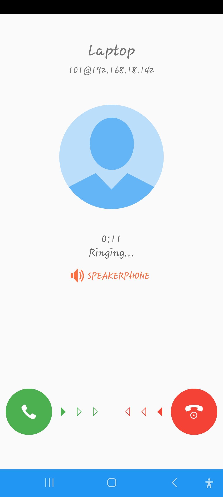

**Figure 7: The phone receiving a call.** Extension 101 calls extension 102 and the phone shows an incoming call.

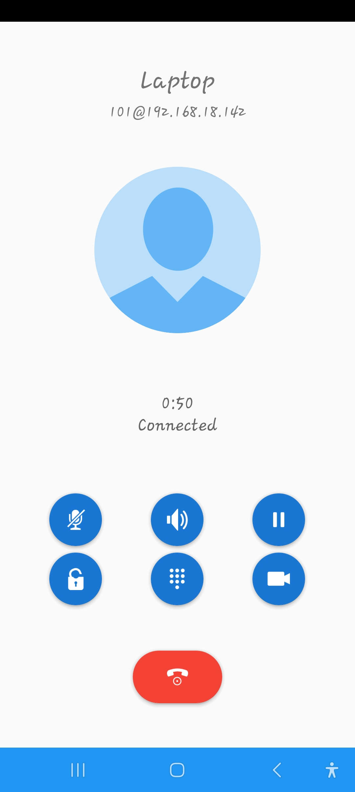

**Figure 8: Call connected.** The phone shows an active call with a running timer (0:50), confirming the call was answered and held.

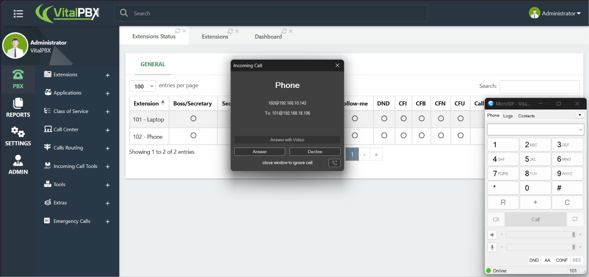

**Figure 9: Call in the opposite direction.** MicroSIP on the laptop shows an incoming call notification from extension 102, so calling works both ways.

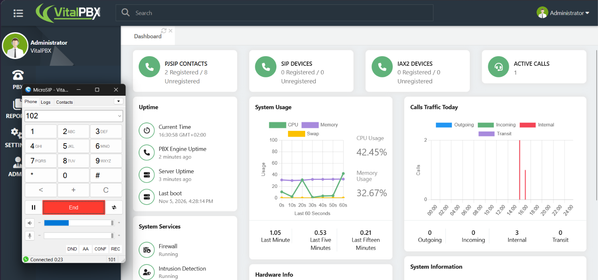

**Figure 10: Active call on the PBX.** While the call is up, the VitalPBX dashboard shows 1 active call.

### Packet capture (Wireshark)

Wireshark was run on the Windows laptop, capturing on the Wi-Fi adapter, which carries the traffic between the laptop, the PBX, and the phone.

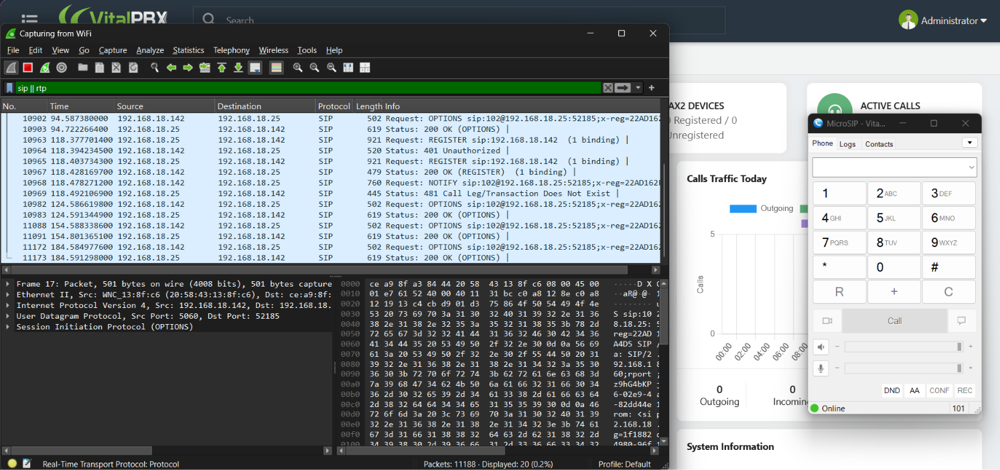

**Figure 11: Registration before the call.** The SIP handshake shows a `REGISTER` request, a `401 Unauthorized` response, and then `200 OK`. The 401 is normal: the server first challenges the client to authenticate, and the client then repeats the request with its credentials.

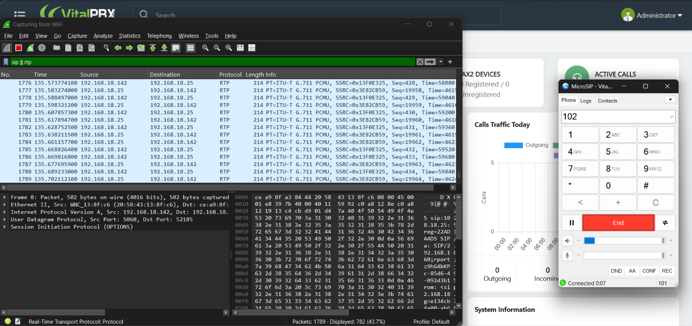

**Figure 12: Voice traffic during the call.** After the call is answered, a steady stream of RTP packets carries the audio between the endpoints. RTP (Real-time Transport Protocol) is the protocol that carries the voice samples, separate from the SIP signaling that sets up the call.

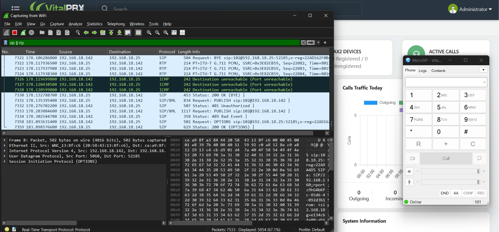

**Figure 13: Call teardown.** When the call ends, one side sends `BYE` and the other answers `200 OK`. ICMP "port unreachable" packets after the call are typical, because the media ports close and late RTP packets have nowhere to go.

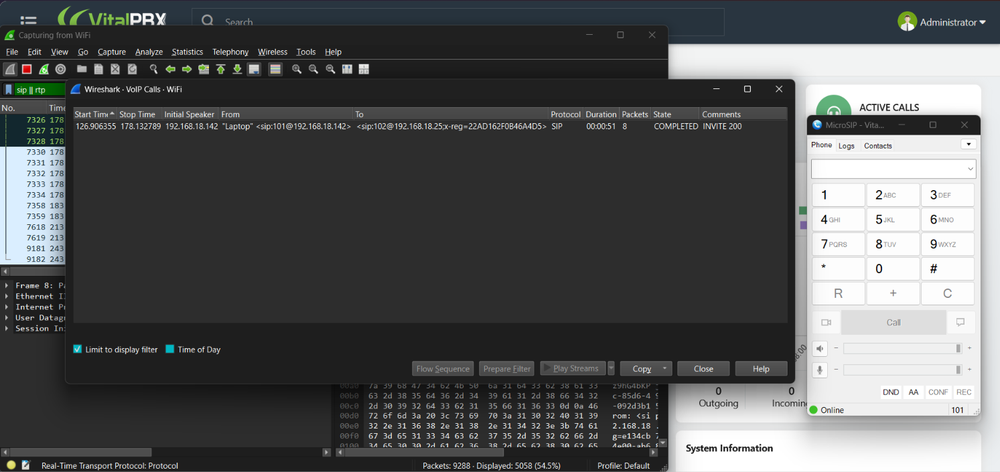

**Figure 14: Wireshark's VoIP Calls view.** Wireshark's telephony tool lists the call from `sip:101@192.168.18.142` to `sip:102@192.168.18.142`, with a duration of 00:00:33 and a completed state.

### Demo video

A recording of the full call flow, from the idle registered state, through a call from 101 to 102 and the RTP traffic during it, to the call ending cleanly:

[Watch the live call demo on YouTube](https://youtu.be/feh2P70ALPo)

## 5. Security: the VitalPBX Firewall

VitalPBX includes its own firewall with whitelist and blacklist handling for source IP addresses. A firewall like this matters on a PBX because SIP servers are constantly probed and attacked from the internet, so the system blocks addresses that look abusive.

In this lab, the phone's address (`192.168.18.25`) had ended up in the firewall's blacklist, most likely after the repeated failed registration attempts. While it was blocked, the phone could not register at all, no matter which app or settings were used. Removing the block by adding the phone's IP to the whitelist fixed registration, and also prevents the same block from returning.

## 6. Troubleshooting Log

**The first installer command failed with "unable to resolve host address".** The command used `https://githubusercontent.com` as its URL, which is not a real download host; GitHub serves raw files from `raw.githubusercontent.com`. Changing the nameserver with `echo "nameserver 8.8.8.8" > /etc/resolv.conf` did not help, because DNS was not the problem. To prove DNS was working, `ping -c 2 raw.githubusercontent.com` and `nslookup raw.githubusercontent.com` both succeeded and resolved to `185.199.110.133`. The script name in that command (`vps.sh`) also belongs to an older VitalPBX install method, so the current official installer (`pbx_installer.sh` for Debian 12) was used instead, as shown in section 2.

**The phone could not register, even though the PBX was reachable.** To separate network problems from SIP problems, the phone's browser was used to open `http://192.168.18.142`, and the VitalPBX login page loaded. That proved the phone had network access to the PBX, which pointed at the firewall. The phone's address was found in the VitalPBX blacklist and whitelisted, and the registration then succeeded (see section 5).

**Calling from 101 to 102 failed immediately with "unavailable".** The softphone on the phone showed "Account is ready" but the PBX disagreed. Checking contacts from the Asterisk CLI showed the problem:

```
asterisk -rvvvvv
pjsip show contacts
```

Extension 102's contact was `Unavail` and its address ended with `transport=TCP`. The Asterisk log showed `PJSIP_ETPNOTSUITABLE` ("Unsuitable transport selected") when the PBX tried to check on that contact. The first softphone (Zoiper) had chosen TCP automatically through its setup wizard and did not let the transport be changed, while the PBX in this lab was configured for UDP. Switching to Sipnetic, which lets the transport be set manually, and choosing UDP fixed it. After that, calls worked in both directions.

**Extra, stale registrations kept appearing for extension 102.** After trying several apps (Zoiper, Linphone, then Sipnetic), the VitalPBX dashboard showed more registered contacts than there were devices. Each app registers from its own source port, and a PJSIP contact remains in the PBX until its registration expires, even if the app is closed. The Asterisk CLI is the reliable view of what is actually registered, and the stored contacts can be listed with:

```
database show registrar/contact
```

A stale entry can be removed with `database del registrar/contact <key>` using the key shown in that list, but in this lab the old entries simply expired on their own. The dashboard counter lagged behind the CLI.

**The VM failed to boot after the Wi-Fi dropped and the VM was rebooted.** The console showed `PXE-E06: Option ROM requires DDIM support`, which means the VM fell back to a network boot because it could not find a bootable disk. The VirtualBox boot order and the storage settings were checked.
